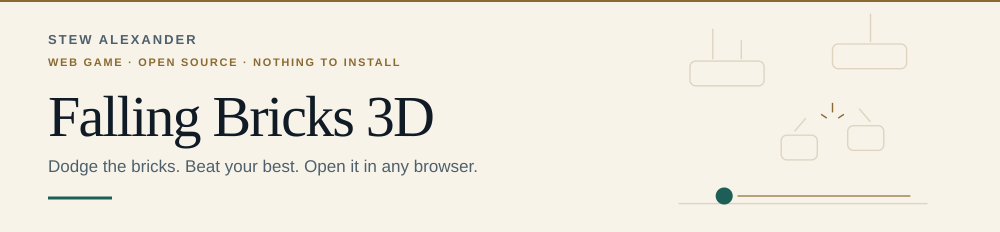
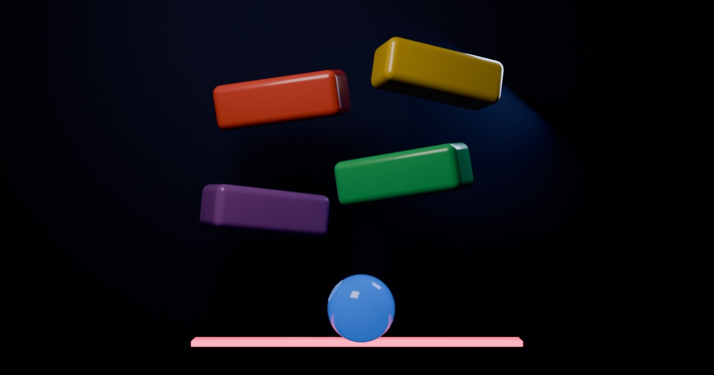

<picture>
  <source media="(prefers-color-scheme: dark) and (max-width: 600px)" srcset="docs/images/masthead-dark-mobile.svg">
  <source media="(max-width: 600px)" srcset="docs/images/masthead-light-mobile.svg">
  <source media="(prefers-color-scheme: dark)" srcset="docs/images/masthead-dark-desktop.svg">
  
</picture>

# Falling Bricks 3D

A 3D web remake of [Falling Bricks ↗](https://github.com/StewAlexander-com/Falling-Bricks-Mobile-Game), the Pythonista iOS dodge game. Same rules and the same *Ode to Joy* soundtrack, plus a new twist from level 4: **cracked bricks** that burst into shards as they fall. Playable in any modern browser on desktop, phone and tablet. Nothing to install.

[](https://stewalexander-com.github.io/falling-bricks-3d/)

[How to play](#how-to-play) · [Settings](#settings) · [What's new](#whats-new) · [Performance](#performance) · [Development](#development)



---

<picture><source media="(prefers-color-scheme: dark)" srcset="docs/images/eyebrow-how-to-play-dark.svg"></picture>

## How to play

Steer the ball left and right to dodge the falling bricks. Your score is the number of seconds you survive.

| Device | Steer | Pause |
|--------|-------|-------|
| Phone / tablet | Drag anywhere on the screen. The ball follows your thumb's movement, so your thumb never covers it. | ❚❚ button |
| Desktop | Move the mouse, or hold ← → or A / D | Esc, P or the ❚❚ button |

- Press **Space** or **Enter** on the title screen to start.
- The game pauses itself if you switch tabs or apps.
- A short "drag to move" prompt appears on your first game and disappears once you move.

<picture><source media="(prefers-color-scheme: dark)" srcset="docs/images/eyebrow-levels-1-3-dark.svg"></picture>

### Learn the drop

- Every **20 seconds** the level goes up: bricks fall faster and waves get bigger. The bar under the HUD shows progress to the next level.
- From **level 3**, each brick gets its own speed, and the spread widens every 3 levels.
- **Read the bricks:** taller, hotter-coloured, brighter bricks with long streaks are the fast ones. Bluer bricks are slower than average.

<picture><source media="(prefers-color-scheme: dark)" srcset="docs/images/eyebrow-level-4-up-dark.svg"></picture>

### Cracked bricks

A banner announces them the first time. A cracked brick:

1. **Flickers white** as it falls, and the flicker speeds up as it gets close to bursting.
2. **Bursts** partway down with a crack and a spray of sparks.
3. Becomes **two smaller shards** that fly apart sideways and bounce off the walls.

The spot under a cracked brick is safe now but won't be in a second, and the gap between its shards gets wider as they fall. Every level adds more cracked bricks, which burst lower and throw their shards faster. The banner reminds you every second level.

| Level | Bricks that are cracked | Warning after a burst |
|-------|-------------------------|-----------------------|
| 4 | about 1 in 5 | 1.15 s |
| 7 | about 2 in 5 | 1.0 s |
| 9 | 1 in 2 (the maximum) | 0.95 s |
| 13+ | 1 in 2 | 0.8 s (the minimum) |

"Warning after a burst" is the minimum time between a burst and its shards reaching your row.

<picture><source media="(prefers-color-scheme: dark)" srcset="docs/images/eyebrow-fair-dark.svg"></picture>

### Always fair, never safe

- There is **always a way through**. Every new brick's path is predicted, including where its shards will go and how they bounce, so at least two ball-sized gaps stay open in your row at every moment.
- There are **no safe spots**. Bricks reach the walls as often as the middle. If you sit in one place for more than about a second and a half, the next brick is aimed at you, so keep moving.
- Brush past a brick without touching it to score a **close call**. It doesn't change your score, but it's counted on the game-over screen.

<picture><source media="(prefers-color-scheme: dark)" srcset="docs/images/eyebrow-phone-dark.svg"></picture>

### Phone tips

- For full-screen play, use **Share → Add to Home Screen** (iOS) or **Install app** (Android/Chrome).
- After the first visit it also works **offline**, without music.
- An installed copy **updates itself**. It checks for a new version whenever you open or return to it, installs it in the background and switches over the next time you're on the main menu, never mid-game. A short "Updated" banner confirms it.
- The game is built for portrait. In landscape it still works, but you'll see a hint to rotate.

---

<picture><source media="(prefers-color-scheme: dark)" srcset="docs/images/eyebrow-settings-dark.svg"></picture>

## Settings

| Setting | What it does |
|---------|--------------|
| Music | Turns *Ode to Joy* on or off |
| Sound effects | Turns level-up, close-call and crash sounds on or off |
| Vibration | Haptic buzz on crashes and close calls (Android only; iOS browsers don't support it, so the option is hidden there) |
| Graphics | **Auto** (recommended), **High**, **Med** or **Low**. Auto starts on High for desktop and Med for phones, and steps down if the frame rate drops below 45 fps. |

Settings, the top-5 leaderboard and your last-used name are saved in your browser (`localStorage`). They stay on the device you play on.

---

<picture><source media="(prefers-color-scheme: dark)" srcset="docs/images/eyebrow-original-dark.svg"></picture>

## What carried over from the original

- Every gameplay constant for levels 1 to 3: brick speeds, the ×1.12 level-up boost, erratic-speed tiers, wave sizes, spawn timing, safe-gap width, and ball and brick sizes
- Speed-encoded bricks: faster bricks are taller and shift toward red; slower ones cool toward blue
- Score = seconds survived, one level every 20 points
- Top-5 leaderboard with names and dates
- *Ode to Joy* background music and the dark brick-wall background

<picture><source media="(prefers-color-scheme: dark)" srcset="docs/images/eyebrow-new-dark.svg"></picture>

## What's new

**Gameplay**
- **Cracked bricks** from level 4, chosen in a playtest against drifting bricks and brick formations (see [`docs/post-level-3-design.md`](docs/post-level-3-design.md))
- **No safe spots:** bricks cover the walls, and staying still draws an aimed brick

**3D graphics**
- Rounded, lit bricks that wobble slightly as they fall, with shadows cast on the original brick wall
- A glossy ball that rolls as it moves, with a glow, a light that follows it and a motion trail
- Debris explosion and screen shake on a crash; sparks on close calls
- A slightly tilted camera that shows the depth of the bricks while keeping the playfield fully visible on any screen shape

**Fixes to the original**
- **Same speed on every screen.** The original moved bricks a fixed number of pixels *per frame*, so it ran twice as fast on 120 Hz screens. Speeds are now per second, so 60, 90, 120 and 144 Hz all play identically.
- **"Always a way through" is now real.** The original README promised random bricks were checked for a clear path, but the code never did it. It's enforced now, with each brick's future path predicted, shards included. In 120 autopilot games, the narrowest gap the ball ever faced was 66 units, for a 30-unit ball.
- **No more wall camping.** The original never placed bricks against the right wall and rarely against the left, so parking the ball there was almost safe. A ball left still at either wall now gets hit within a few seconds.
- **On-screen brick limit enforced.** `MAX_LIVE_BRICKS` was defined in the original but never used.

**Interface**
- Title screen with the game running in the background, plus pause, settings, top scores and game-over screens
- HUD with score, level, best score and a level-progress bar
- Level-up banners that explain new mechanics when they kick in
- Your score is saved the moment you die, and you can edit your name afterwards
- A short delay before **Play again** works, so a panicked tap doesn't restart instantly
- Installed copies update themselves, only between games
- Large touch targets, keyboard focus outlines, iPhone notch and home-bar spacing, and support for the system "reduce motion" setting

---

<picture><source media="(prefers-color-scheme: dark)" srcset="docs/images/eyebrow-performance-dark.svg"></picture>

## Performance

Measured in Comet (Chromium) on a Mac with a 120 Hz display:

| Scenario | Frame rate | Draw calls |
|----------|-----------|------------|
| Desktop, High graphics | 120 fps (95th-percentile frame 10 ms) | ~17 per frame |
| Phone-size touch emulation, Med graphics | 120 fps | ~17 per frame |

The full download is about **150 KB of compressed JavaScript** plus a 48 KB wall texture. The 2.1 MB music file streams separately after you press Play, so it never delays the start.

<picture><source media="(prefers-color-scheme: dark)" srcset="docs/images/eyebrow-browsers-dark.svg"></picture>

## Browser support

Recent Chrome, Edge, Safari (macOS and iOS), Firefox and Samsung Internet. WebGL is required. The music is AAC (`.m4a`), with an Opus (`.webm`) fallback for browsers without AAC.

---

<picture><source media="(prefers-color-scheme: dark)" srcset="docs/images/eyebrow-development-dark.svg"></picture>

## Development

Requires Node.js 20.19+ or 22.12+.

```bash
npm install
npm run dev        # http://localhost:5173/falling-bricks-3d/
npm run build      # type-check + production build into dist/
npm run preview    # serve the production build locally
```

<details>
<summary><b>Game modes and playtesting</b></summary>

Cracked bricks won a playtest against two other post-level-3 mechanics, which are still in the code for comparison. Pick one with `?mode=`:

| `?mode=` | After level 3 |
|----------|---------------|
| `split` (default) | Cracked bricks burst into two shards |
| `drift` | Some bricks slide sideways and bounce off the walls |
| `formation` | Choreographed patterns (Slalom, Funnel, Staircase, Zipper) after a short lull |
| `classic` | The original game, with no new mechanic |

Other testing parameters: `?level=3` starts at level 3, and `?bot` lets the autopilot steer. They combine, for example `?mode=drift&level=6&bot`.

`npm run playtest -- 40` has the autopilot play 40 games of each mode headlessly and prints survival times, how often it had to change direction, close calls and the narrowest corridor it faced. The design notes and results are in [`docs/post-level-3-design.md`](docs/post-level-3-design.md).

</details>

Add `?debug` to the URL to expose `sim`, `renderer`, `sound`, `store` and `game` on `window` for inspection in the browser console.

### Deployment

Every push to `main` builds and deploys to GitHub Pages through [`.github/workflows/deploy.yml`](.github/workflows/deploy.yml). The site's base path (`/falling-bricks-3d/`) is set in `vite.config.ts`.

<details>
<summary><b>Project structure</b></summary>

| Path | Purpose |
|------|---------|
| `src/config.ts` | Every gameplay constant, converted from the original's per-frame values to per-second |
| `src/sim.ts` | Game rules, brick generation, the post-level-3 modes, the predictive clear-path check, collision and the autopilot. No rendering |
| `scripts/playtest.ts` | Headless autopilot playtest that compares the modes |
| `src/render.ts` | Three.js scene: bricks drawn in a single GPU call, ball, lighting, effects, camera fitting, graphics quality levels |
| `src/audio.ts` | Music through Web Audio (so volume works on iOS) and sound effects generated in code |
| `src/main.ts` | Game states, input, HUD, menus and the main loop |
| `src/storage.ts` | Leaderboard and settings saved in `localStorage` |
| `src/style.css` | Menus and HUD styling |
| `public/audio/` | *Ode to Joy*, re-encoded for the web from the original |
| `public/img/wall.webp` | The original brick-wall background, compressed |
| `public/icons/`, `public/og.jpg` | App icons and link-preview image, modelled and rendered in Blender |

The PWA build (via `vite-plugin-pwa`) generates the web app manifest and service worker. The music is left out of the offline cache because Safari streams audio in chunks, which breaks precaching.

The service worker is registered in `src/main.ts` rather than by the plugin. The app checks for a new version on launch, whenever it returns to the foreground, every 30 minutes and when the device comes back online. A new service worker takes over as soon as it's installed. The page reloads into the new version only on the main menu, or when it's hidden on the game-over screen, so a deploy never interrupts a run.

</details>

<details>
<summary><b>README artwork</b></summary>

The masthead, eyebrow labels, call-to-action and footer strip are generated from a single palette in [`scripts/readme-theme.ts`](scripts/readme-theme.ts), which mirrors the design tokens of [StewAlexander.com ↗](https://stewalexander.com): Georgia headings with tight tracking, Arial body copy, gold uppercase eyebrows, mint links, and panels topped with a 2px gold rule. Each piece ships in a light and a dark variant, picked with `prefers-color-scheme`.

```bash
npm run theme      # rewrite docs/images from the palette
```

</details>

---

<picture><source media="(prefers-color-scheme: dark)" srcset="docs/images/eyebrow-credits-dark.svg"></picture>

## Credits

- Original game: [Falling Bricks ↗](https://github.com/StewAlexander-com/Falling-Bricks-Mobile-Game) by StewAlexander-com, built with Pythonista's `scene` module
- 3D engine: [Three.js ↗](https://threejs.org/)
- Build tooling: [Vite ↗](https://vite.dev/) and [vite-plugin-pwa ↗](https://vite-pwa-org.netlify.app/)
- Music: public-domain arrangement of Beethoven's *Ode to Joy*, carried over from the original
- Icon and share image: modelled and rendered in [Blender ↗](https://www.blender.org/)

<picture><source media="(prefers-color-scheme: dark)" srcset="docs/images/eyebrow-license-dark.svg"></picture>

## License

[GPL-3.0](LICENSE), same as the original.

<a href="https://stewalexander.com">
  <picture>
    <source media="(prefers-color-scheme: dark) and (max-width: 600px)" srcset="docs/images/footer-dark-mobile.svg">
    <source media="(max-width: 600px)" srcset="docs/images/footer-light-mobile.svg">
    <source media="(prefers-color-scheme: dark)" srcset="docs/images/footer-dark-desktop.svg">
    
  </picture>
</a>
